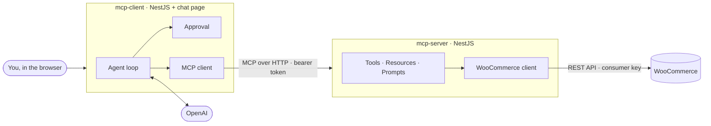

# WooCommerce MCP

An MCP server and an AI agent that work with an existing WooCommerce store. The agent reads products, orders and stock through the server, and every change to the store waits for a person to approve it.

Built with NestJS and the official MCP TypeScript SDK (protocol 2026-07-28). The agent loop is written by hand rather than taken from a framework.



## What it does

- **12 tools** for products, orders, stock and customers, each checking the caller's permissions and the store's business rules.
- **Resources** for store info, settings, the catalog, and any product or order by ID.
- **5 prompts** for order analysis, customer replies, product copy, an inventory review and a sales summary.
- **A chat page** where you talk to the agent, watch its tool calls live, and approve or decline every change.
- **Safety:** reads run automatically, writes ask first, and deletes require typing the tool name. Customer emails are masked, and the store key never leaves the server.

## Run it

Requires Node.js 22 and pnpm 9. A bundled mock store stands in for WooCommerce, so no real store is needed.

```bash
pnpm install
pnpm build
cp .env.example .env

pnpm dev:mock      # terminal 1: mock WooCommerce store
pnpm dev:server    # terminal 2: MCP server
pnpm dev:client    # terminal 3: agent, then open http://localhost:4000
```

To chat, put your OpenAI key in `.env` as `OPENAI_API_KEY` and restart the client. Without a key, the page still connects and lists the tools.

With Docker instead: `docker compose up -d --build`, then open http://localhost:4000.

## Configuration

`.env` holds only what you normally set:

| Variable | Meaning |
| --- | --- |
| `WOO_BASE_URL` | The store. The mock runs at `http://127.0.0.1:8080`. Use `https://` for a real store. |
| `WOO_CONSUMER_KEY`, `WOO_CONSUMER_SECRET` | The store's REST API key (WooCommerce → Settings → Advanced → REST API). |
| `MCP_CLIENT_TOKEN` | Shared secret between the agent and the server, at least 16 characters. |
| `OPENAI_API_KEY` | Needed only to chat. |

Optional overrides, with their defaults:

| Variable | Default |
| --- | --- |
| `MCP_PORT`, `CLIENT_PORT` | `3000`, `4000` |
| `OPENAI_MODEL` | `gpt-5-mini` |
| `MCP_CLIENTS` | Several clients with their own permissions, as JSON: `[{"id","token","scopes"}]` |
| `MCP_EXTRA_SERVERS` | More MCP servers for the agent, as JSON: `[{"name","url","token"}]` |
| `MCP_RATE_LIMIT_PER_MINUTE` | `120` |
| `LOG_LEVEL` | `info` |

To use a real store, test against a **staging** copy: the agent can change stock and orders.

## Project layout

```
apps/
  mcp-server/     NestJS MCP server
    src/core/       config, auth, rate limit, health, MCP transport, WooCommerce client
    src/modules/    product, order, inventory, customer, store, sales
    tests/          integration tests over real HTTP
  mcp-client/     NestJS agent and chat page
    src/core/       config, error handling
    src/modules/    connection, discovery, llm, agent, approval, chat, status
    public/         the chat page
    tests/          integration and end-to-end tests
  woo-mock/       NestJS imitation of the WooCommerce REST API
packages/
  shared/         schemas, error codes and the logger used by the apps
learn/            a standalone MCP course (static site, deployed to Netlify on its own)
```

## Tests

```bash
pnpm build && pnpm test
```

110 tests: unit tests next to the code, server integration tests against the official SDK client, and end-to-end runs from a scripted model through the agent, the server and the mock store. The mock store can inject failures (errors, timeouts), so the unhappy paths are tested too.

## Not yet

- OAuth for MCP clients (static tokens today).
- Creating and editing products, and coupons.
- Shared storage for idempotency and rate limits when running several servers.
- A login for the chat page. It is local only, and Docker publishes it on localhost.
