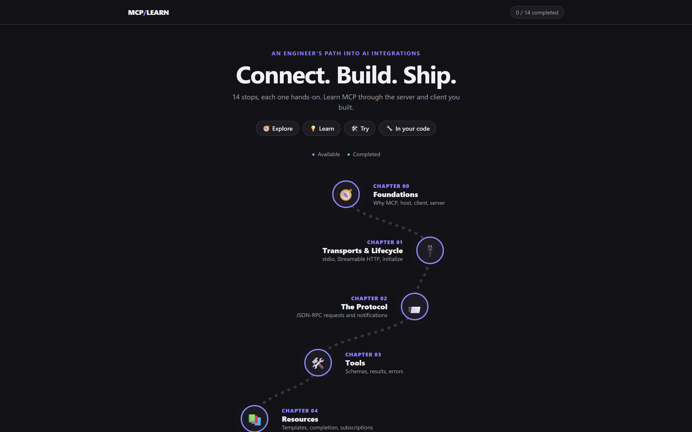

# 🧭 MCP/LEARN

**Connect. Build. Ship.**

A hands-on journey into the Model Context Protocol: servers, clients, agents and production.

🌐 **Live:** [explore-mcp.netlify.app](https://explore-mcp.netlify.app/)

## How it works

Every chapter follows the same path:

🧭 **Explore** → 💡 **Learn** → 🛠️ **Try** → 🔧 **Builder's Lens**

Interactive demos, short bullets, and practical notes on how to build each concept yourself.

## Chapters

| 🔌 The protocol | 🤖 Clients, agents & production |
|---|---|
| 00 · [Foundations](chapters/00-foundations.html) | 07 · [Building a Client](chapters/07-client.html) |
| 01 · [Transports & Lifecycle](chapters/01-transports-lifecycle.html) | 08 · [The Agent Loop](chapters/08-agent-loop.html) |
| 02 · [The Protocol](chapters/02-protocol.html) | 09 · [Human in the Loop](chapters/09-human-approval.html) |
| 03 · [Tools](chapters/03-tools.html) | 10 · [Auth & Scopes](chapters/10-auth-scopes.html) |
| 04 · [Resources](chapters/04-resources.html) | 11 · [Security & Privacy](chapters/11-security-privacy.html) |
| 05 · [Prompts](chapters/05-prompts.html) | 12 · [Testing & Shipping](chapters/12-testing-shipping.html) |
| 06 · [Long-running Work](chapters/06-long-running-work.html) | 13 · [Capstone](chapters/13-capstone.html) |

## Run it

Plain HTML, CSS and JavaScript. No install, no build.

**1. Start a local server in this folder** (pick one)

- **VS Code:** *Live Server* → right-click `index.html` → **Open with Live Server**
- **Node:** `npx serve .`
- **Python:** `python -m http.server 5500`

**2. Open it in your browser**

Start from the journey map. Your progress is saved in the browser.

## Deploy

On Netlify, set the **base directory** to `learn` and leave the build command empty. `netlify.toml`, `_redirects` and `404.html` are already in this folder.
